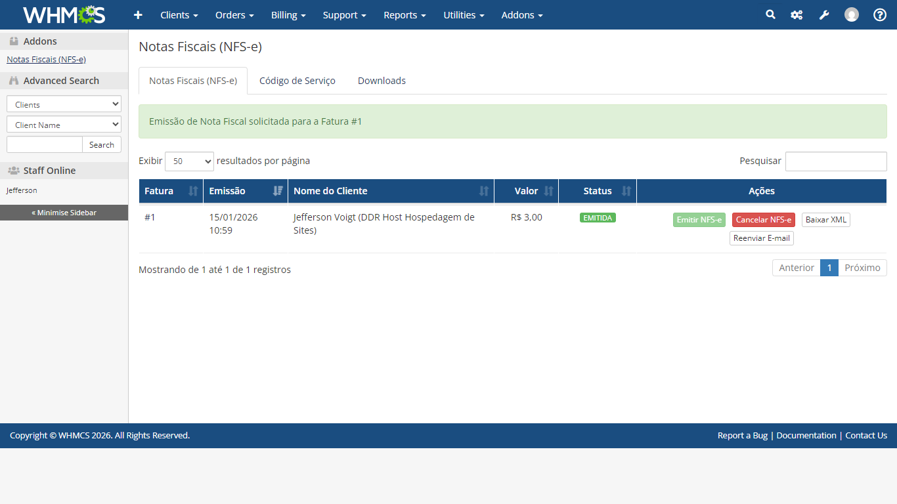
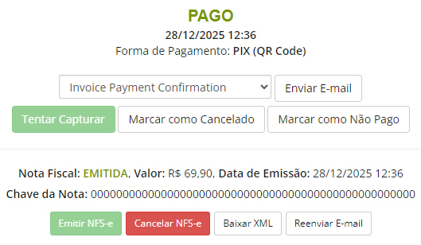
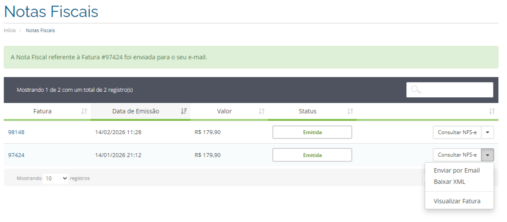

# Módulo de Notas Fiscais (NFS-e) para WHMCS via API Nacional

> Automatize a emissão de **NFS-e** no WHMCS com integração direta ao **Ambiente Nacional** (Sefin Nacional / nfse.gov.br).

Este módulo integra o WHMCS à **API Nacional de NFS-e**, permitindo operar a rotina completa de emissão de notas fiscais de serviço **SEM DEPENDER DE TERCEIROS** e **SEM COBRANÇA POR NOTA FISCAL**.

Permite emissão manual ou automática, cancelamento, download do XML e reenvio de e-mail, com controles por gateway, grupo de cliente e mapeamento de Código de Serviço.



---

## Principais Recursos

- Emissão de NFS-e diretamente no WHMCS via API Nacional
- Emissão manual (ação sob demanda no Admin)
- Emissão automática após pagamento (conforme regras do módulo)
- Emissão automática no momento da geração da fatura (via CRON configurável)
- Personalização do modo de emissão por cliente (Manual / Após Pagamento / Ao Gerar Fatura)
- Cancelamento de NFS-e (quando status = emitida)
- Download do XML (Admin e ClientArea)
- Reenvio de e-mail da NFS-e
- Painel de listagem de notas emitidas no Admin (com busca e ordenação)
- Relatório de notas fiscais emitidas e canceladas (PDF e CSV)
- Relatório individual de NFS-e em PDF
- Acompanhamento de status: Emitida, Cancelada, Erro
- Página própria na Área do Cliente (`index.php?m=Nfse`)
- Consulta pública da NFS-e via chave de acesso integrada ao Portal Nacional
- Compatível com Simples Nacional, Lucro Presumido e Lucro Real
- Compatível com Código 990101 (serviços sem incidência de ISS/ICMS)
- Campo de Inscrição Municipal do Emissor
- Campo de Código NBS
- Campo de Código de Serviço Complementar (quando exigido pelo município)
- Novos campos para personalização de tributos
- Código otimizado, unificado e compatível com múltiplas versões de PHP/ionCube



---

## Instalação do Módulo

### 1 – Baixar e descompactar o módulo

Faça o download do módulo de Nota Fiscal fornecido pela DDR Host em seu computador.

Após concluir o download, descompacte o arquivo para ter acesso à pasta e aos arquivos de instalação.

### 2 – Acessar os arquivos do WHMCS

Acesse o servidor onde o WHMCS está instalado utilizando um programa de FTP, como o FileZilla, ou o **Gerenciador de Arquivos** do cPanel.

### 3 – Enviar os arquivos do módulo

Localize a pasta de instalação do WHMCS no servidor e envie a pasta do módulo para o seguinte caminho:

```text
/modules/addons/Nfse/
```

**IMPORTANTE:** O nome da pasta deve ser exatamente `Nfse`. Não altere letras maiúsculas, minúsculas ou o nome da pasta, pois o WHMCS utiliza esse nome para identificar o módulo.

### 4 – Ativar o módulo no WHMCS

Após enviar todos os arquivos, acesse o painel administrativo do WHMCS.

No menu superior direito, clique no símbolo da **ENGRENAGEM** e depois acesse **Opções > Módulos Adicionais (Addon Modules)**.

Localize o módulo de **Notas Fiscais (NFS-e)**, clique em **ATIVAR** e, em seguida, clique em **CONFIGURAR** para acessar as opções de configuração.

### 5 – Configurar o módulo de Nota Fiscal

Após ativar o módulo, será necessário preencher os campos de configuração para identificar sua empresa, configurar os dados fiscais e definir como as notas fiscais serão emitidas.

As opções estão organizadas nas seções detalhadas a seguir.

---

## Configuração do Módulo

### Licença e Dados da Empresa

| Campo | Descrição |
|---|---|
| **Chave da Licença** | Informe a chave de licença fornecida no momento da contratação do módulo. Após inserir a chave corretamente, o status da licença será exibido como ativo. |
| **CNPJ da Empresa** | Informe o CNPJ da sua empresa, utilizando apenas números. Esse será o CNPJ utilizado para emitir as notas fiscais. |
| **E-mail da Empresa** | Informe o endereço de e-mail oficial da sua empresa. Esse endereço será exibido na Nota Fiscal. |
| **Telefone da Empresa** | Informe o telefone da empresa com DDD, utilizando somente números. Esse telefone será exibido na Nota Fiscal. |
| **Código do Município (IBGE)** | Informe o código IBGE da cidade onde sua empresa está localizada. Esse código identifica o município emissor da Nota Fiscal e é obrigatório para a emissão. [Consulte os códigos dos municípios no IBGE](https://www.ibge.gov.br/explica/codigos-dos-municipios.php). |
| **Inscrição Municipal da Empresa** | Informe a inscrição municipal da sua empresa, conforme a orientação do contador. Na maioria das vezes, este campo não precisa ser preenchido. |

### Nota Fiscal

| Campo | Descrição |
|---|---|
| **Endpoint da API Nacional** | Este campo já vem preenchido com o endereço oficial da API Nacional de NFS-e. Não altere este campo, a menos que seja orientado pelo suporte. |
| **Código de Serviço Padrão** | Informe o código padrão do serviço prestado pela sua empresa. Esse código identifica o tipo de serviço na Nota Fiscal. Para serviços de hospedagem de sites, utilize o código `010302`. [Consulte os códigos de tributação nacional](https://www.gov.br/nfse/pt-br/mei-e-demais-empresas/codigos-de-tributacao-nacional-nbs). |
| **Código Complementar Padrão** | Informe o código padrão do serviço complementar prestado pela sua empresa. Esse código deve ser preenchido conforme a orientação do contador ou do município. Na maioria dos casos, este campo pode ficar em branco. |
| **Código NBS Padrão** | Informe o código NBS padrão do serviço prestado pela sua empresa. Esse código identifica o tipo de serviço na Nota Fiscal no novo modelo NBS e é composto por 9 números. Para serviços de hospedagem de sites, utilize o código `115061000`. [Consulte a Nomenclatura Brasileira de Serviços](https://www.gov.br/mdic/pt-br/assuntos/sdic/comercio-e-servicos/nbs-nomenclatura-brasileira-de-servicos). |
| **Série da NFS-e** | Informe o número da série da Nota Fiscal. Normalmente, é utilizado um número simples, como `900`, para controle da numeração das notas. |

### Certificado Digital A1

| Campo | Descrição |
|---|---|
| **Caminho do Certificado** | Informe o caminho completo no servidor de hospedagem onde está armazenado o arquivo do Certificado Digital A1 (`.pfx`) da empresa. O nome do arquivo não pode conter espaços nem caracteres especiais. Exemplo: `/home/seu-usuario/certificado/certificado.pfx`. |
| **Senha do Certificado** | Informe a senha do Certificado Digital A1. Caso o certificado não possua senha, deixe este campo em branco. |

O módulo possui suporte a Certificado Digital A1 nos formatos `.pfx` e `.p12`, conforme os recursos de integração disponíveis.

### Dados do Cliente

| Campo | Descrição |
|---|---|
| **Campo CPF/CNPJ (Cliente)** | Selecione o campo do cadastro do cliente no WHMCS que contém o CPF ou CNPJ. Esse campo é obrigatório para a emissão da Nota Fiscal. |
| **Campo Inscrição Municipal (Cliente)** | Selecione o campo que contém a Inscrição Municipal do cliente, utilizado nos cadastros de clientes com CNPJ. Caso não queira configurar essa informação, deixe a opção como **Nenhum**. |

### Nota Fiscal - Adicionais

| Campo | Descrição |
|---|---|
| **Exibir Número da Fatura** | Quando ativado, o número da fatura será exibido na Nota Fiscal, facilitando a identificação do pagamento correspondente. |
| **Descrição Adicional** | Informe um texto opcional que será exibido na Nota Fiscal, entre o número da fatura e a descrição dos serviços da fatura do WHMCS. |

### Impostos

| Campo | Descrição |
|---|---|
| **Retenção de ISS Padrão (%)** | Informe o percentual de ISS que será retido pelo Tomador (Cliente), caso aplicável. Utilize ponto para separar as casas decimais. Exemplo: `2.00`. Se não houver retenção, deixe este campo em branco. |
| **Campo ISS Padrão (Cliente)** | Caso alguns clientes possuam uma retenção de ISS diferente do padrão, selecione o campo do cadastro do cliente onde esse percentual será informado. O valor preenchido nesse campo será utilizado para substituir a configuração do ISS Padrão. |
| **Aplicar Desconto de ISS na Fatura** | Quando ativado, o módulo calcula automaticamente o valor correspondente ao percentual de ISS informado para o tomador e aplica esse valor como desconto sobre o total da fatura. Essa opção permite considerar o ISS retido pelo cliente como um abatimento no valor da cobrança, evitando que o valor correspondente ao imposto seja incluído integralmente no total a pagar. |
| **Total de Tributos SN (%)** | Informe o percentual total de tributos recolhidos pela sua empresa para que essa informação seja exibida na Nota Fiscal. Este campo é opcional e somente deve ser utilizado se o regime tributário da sua empresa for o **Simples Nacional**. |

**IMPORTANTE:** A retenção de ISS depende das regras do município e do tipo de serviço prestado. Em caso de dúvida, consulte seu contador.

Para utilizar o campo **ISS Padrão (Cliente)**, recomendamos criar o campo personalizado correspondente no WHMCS com a opção **Somente Admin** marcada. Dessa forma, somente o administrador poderá gerenciar o percentual de retenção, impedindo que o próprio cliente preencha ou altere essa informação.

A opção **Aplicar Desconto de ISS na Fatura** é opcional e deve ser habilitada somente quando essa regra de tratamento do ISS se aplicar às operações da sua empresa.

### Reforma Tributária (IBS/CBS)

| Campo | Descrição |
|---|---|
| **Habilitar Reforma Tributária** | Ative esta opção para permitir que o módulo inclua as informações referentes ao IBS e à CBS na DPS durante o processo de emissão da Nota Fiscal. Quando habilitada, os dados tributários configurados no módulo são enviados para processamento pela Sefin Nacional. Os valores efetivos dos impostos e seus respectivos totalizadores são calculados pelo sistema nacional e retornam na Nota Fiscal. |
| **Indicador da Operação (cIndOp)** | Informe o código de seis dígitos que identifica o indicador da operação de fornecimento, conforme a tabela oficial de Indicadores de Operação do IBS/CBS. Esse código identifica as características da operação realizada e auxilia no enquadramento da tributação correspondente. Sua definição deve considerar o tipo de serviço prestado e as características da operação. Exemplo: `050101`. |
| **CST IBS/CBS** | Informe o Código de Situação Tributária (CST) correspondente ao IBS e à CBS. Esse código identifica a situação tributária aplicável à operação e determina como as informações relacionadas à tributação deverão ser tratadas na DPS. O CST possui três dígitos e deve ser definido conforme o enquadramento tributário da operação, mantendo compatibilidade com o código de Classificação Tributária informado no campo seguinte. Exemplo: `000`. |
| **Classificação Tributária (cClassTrib)** | Informe o código de Classificação Tributária correspondente à operação realizada pela sua empresa. Esse código complementa as informações do CST, identificando a classificação tributária específica aplicável à operação no modelo IBS/CBS. O código é composto por seis dígitos e deve ser selecionado de acordo com o enquadramento tributário do serviço prestado, observando a compatibilidade com o CST e as tabelas oficiais de classificação. Exemplo: `000001`. |

**IMPORTANTE:** A definição dos códigos e do enquadramento tributário deve considerar as características da operação e as orientações do contador da empresa.

### Configurações

| Campo | Descrição |
|---|---|
| **Modo de Emissão Padrão** | Selecione como deseja que as notas fiscais sejam emitidas por padrão. As opções permitem configurar a emissão automática após o pagamento da fatura, ao gerar a fatura pelo CRON do WHMCS ou de forma manual. |
| **Modo de Emissão por Cliente** | Selecione esta opção caso queira configurar uma forma diferente de emissão da Nota Fiscal para cada cliente, permitindo definir se a emissão ocorrerá após o pagamento, ao gerar a fatura ou manualmente. |
| **Meios de Pagamento** | Selecione quais formas de pagamento deverão permitir a emissão automática da Nota Fiscal, como **Boleto, PIX e Cartão**. |
| **Criar Tarefas** | Quando ativado, o sistema cria uma tarefa interna no WHMCS sempre que ocorrer algum erro durante a emissão da Nota Fiscal. |
| **Enviar E-mail** | Quando ativado, o cliente receberá um e-mail automático informando que a Nota Fiscal foi emitida. |
| **Debug** | Exibe mensagens detalhadas de erro. Esta opção deverá ser habilitada somente quando uma mensagem de erro genérica não for suficiente para identificar o problema ocorrido durante a emissão da Nota Fiscal. Utilize essa configuração apenas quando for necessário realizar um diagnóstico técnico. |

---

## Código de Serviço — Diferencial do Módulo

A aba **Código de Serviço** permite controlar com precisão a classificação do serviço na NFS-e.

### Configuração Global

- Código de Serviço padrão global
- Código padrão aplicado automaticamente quando o campo estiver em branco

### Configuração por Produto/Serviço

- Código de Serviço individual por Produto/Serviço
- Herança automática do Código de Serviço padrão quando não definido

### Configuração para Domínios

- Código de Serviço exclusivo para:
  - Registro de Domínio
  - Transferência de Domínio
  - Renovação de Domínio

### Regras Inteligentes

- Código vazio utiliza automaticamente o Código de Serviço padrão
- Permite personalização por tipo de item faturado
- Evita classificação incorreta na NFS-e
- Compatível com exigências municipais
- Suporte a Código de Serviço Complementar quando exigido

---

## Área do Cliente (ClientArea)

O módulo possui página própria na área do cliente:

`index.php?m=Nfse`

### Funcionalidades

- Listagem de todas as NFS-e do cliente (Emitidas e Canceladas)
- Ordenação por Data, Valor e Status (DataTables)
- Filtro por status (Emitida / Cancelada)
- Download do XML
- Reenvio de e-mail
- Consulta pública via chave de acesso (integração direta com o Portal Nacional)
- Visualização da fatura vinculada
- Mensagens de sucesso e erro após ações
- Layout dedicado compatível com tema Lagom
- Layout dedicado compatível com tema Six



---

## Controles e Regras Operacionais

- Restrição de emissão automática por Gateways
- Restrição de emissão automática por Cliente
- Mapeamento de CPF/CNPJ via Campo Personalizado
- Emissão imediata, via CRON (Antecipado), na geração da fatura ou manual configurável
- Cancelamento protegido por status
- Tratamento aprimorado e detalhado de mensagens de erro
- Registro automático de falhas para auditoria

---

## Configurando a Emissão Personalizada por Cliente

Para utilizar a funcionalidade de **Personalização do Modo de Emissão por Cliente**, será necessário criar um campo personalizado nos cadastros dos clientes do WHMCS.

No painel administrativo do WHMCS, acesse:

**Configurações > Campos Personalizados dos Clientes**

Crie um novo campo utilizando exatamente as configurações abaixo:

| Configuração | Valor |
|---|---|
| **Nome do Campo** | `Modo de Emissão` |
| **Tipo do Campo** | Lista de Opções |
| **Selecionar Opções** | `Padrão do Módulo,Manual,Quando a fatura é Paga,Quando a fatura é Gerada` |
| **Somente Admin** | Ativado |
| **Campo Obrigatório** | Ativado |
| **Mostrar no Formulário de Pedidos** | Desativado |
| **Exibir na Fatura** | Desativado |

Após salvar, esse campo ficará disponível no perfil de cada cliente no painel administrativo do WHMCS.

A partir daí, será possível definir individualmente o comportamento da emissão de NFS-e para cada cliente:

- **Padrão do Módulo:** utiliza as configurações globais definidas no módulo de Nota Fiscal.
- **Manual:** a emissão deverá ser realizada manualmente pelo administrador.
- **Quando a fatura é Paga:** permite a emissão automática após a confirmação do pagamento da fatura.
- **Quando a fatura é Gerada:** permite a emissão automática no momento da geração da fatura, conforme a rotina configurada.

Caso o campo não seja criado ou permaneça configurado como **Padrão do Módulo**, o sistema seguirá exatamente as configurações globais definidas no módulo de Nota Fiscal.

**IMPORTANTE:** O nome do campo e os nomes das opções devem ser exatamente iguais aos apresentados neste exemplo, sem nenhuma alteração. Caso sejam utilizados nomes diferentes, a funcionalidade de emissão personalizada não irá funcionar.

---

## Exibindo as Informações da Nota Fiscal na Fatura

Para exibir as informações da Nota Fiscal diretamente na página da fatura do WHMCS, será necessário realizar uma pequena alteração no arquivo `viewinvoice.tpl` do template utilizado.

### 1 – Localizar o arquivo do template

Localize o arquivo `viewinvoice.tpl` do seu template WHMCS.

No template padrão Six, geralmente ele está localizado no seguinte caminho:

```text
/templates/six/viewinvoice.tpl
```

### 2 – Localizar a linha de referência

Abra o arquivo e localize a seguinte linha:

```html
<div class="panel panel-default">
```

### 3 – Adicionar o código do módulo

Logo acima dessa linha, adicione o seguinte código:

```smarty
{include file="../../modules/addons/Nfse/templates/nfse-emitida.tpl"}
```

Após salvar o arquivo, as informações da Nota Fiscal emitida poderão ser exibidas diretamente na página da fatura.

---

## Operação no Admin

- Listagem com DataTables (busca e ordenação)
- Botões de ação rápida:
  - Emitir NFS-e
  - Cancelar NFS-e
  - Baixar XML
  - Reenviar E-mail
- Regras automáticas de habilitar/desabilitar botões por status
- Operação segura para volume elevado
- Relatórios exportáveis para contador (PDF e CSV)

---

## Armazenamento e Recuperação do XML

- Armazenamento do XML no banco de dados
- Suporte a XML retornado compactado (`nfseXmlGZipB64`)
- Extração automática do XML para download
- Preserva dados relevantes mesmo em fluxos de erro

---

## Certificado Digital

- Suporte a Certificado A1 (.pfx / .p12)
- Tratamento de erro SSL
- Compatível com PHP 7.2+
- Debug avançado para diagnóstico

---

## Logs e Auditoria

- Registro no Activity Log do WHMCS
- Registro detalhado de erros
- Criação automática de To-Do em caso de falha (configurável)
- Histórico completo para auditoria
- Registro estruturado de falhas HTTP e retorno da API Nacional

---

## E-mails

- Template WHMCS: "Nota Fiscal"
- Envio automático após emissão
- Reenvio manual pelo Admin
- Reenvio pelo Cliente (quando permitido)
- Envio com chave de acesso e link para consulta pública

---

## Estrutura de Status

| Status | Comportamento |
|---|---|
| **Emitida** | Permite XML, consulta pública e reenvio |
| **Cancelada** | Apenas visualização |
| **Erro** | Registro mantido para auditoria |

---

## Referências

Portal Nacional de Consulta Pública:

https://www.nfse.gov.br/consultaPublica

---

## Compra

Adquira o módulo diretamente pela DDR Host:

https://cliente.ddrhost.com.br/cart.php?a=add&pid=281
